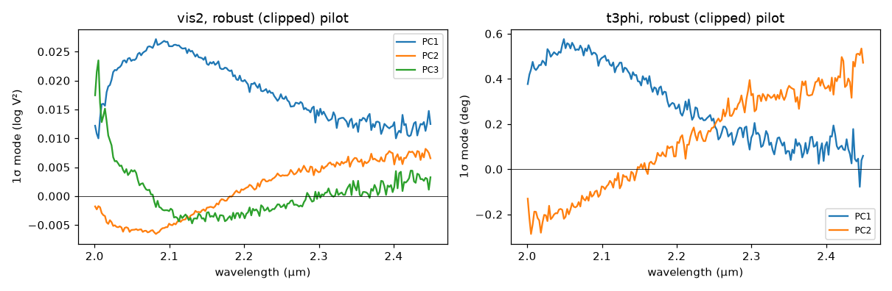

# Plan: an empirical model of GRAVITY systematics from archival calibrators

*Moved here from virgil's `design/` folder on 2026-10-04, when the GRAVITY project became virgil-vlti; its history is in [benjaminpope/virgil](https://github.com/benjaminpope/virgil/commits/main/design/gravity_calibrator_pca.md). "The separate GRAVITY project" below means this repository.*

Status: **in progress**, 2026-10-04; updated 2026-10-18: three templates ship (MEDIUM pilot, HIGH, MEDIUM without the WR-survey calibrators; see [HIGH resolution and the MEDIUM rebuild](#high-resolution-and-the-medium-rebuild-2026-10-18)). The analysis code is `virgil_vlti.calpca` (`virgil-vlti-calpca`); the pilot (single field, MEDIUM, combined polarisation, 2023–2025: 445 files, 6.6 GB) runs as a cluster job. Two choices differ from the plan below: the residuals are **leave-one-out calibrations of calibrators** by the night's other stars (what a science fit inherits), not raw ratios to the model; and σ includes the other calibrators' errors carried through the interpolation, so that what is left is systematic. Originally planned 2026-10-03. This belongs to the **separate GRAVITY project**, which begins once the core of the package (renamed virgil) works (2026-10-03). It answers open question 4 of [`gravity_calibration_review.md`](gravity_calibration_review.md).

## Pilot, first run (2026-10-04, virgil-vlti 18890f6)
- **Yield:** 445 files read; 130 of them (47 nights) had another star of the same setup and stations. Only those give residuals.
- **No screening, full band:** V² χ² per sample is 90 before any component, and cross-validation keeps adding components to k = 6. The closure phases' leading component is a smooth 30° hump across K, peaking near 2.3 µm, and V²'s leading component is a ~25% offset. Both point to **calibrators that are not uniform disks** (binaries, wrong diameters) rather than to instrumental systematics. Every component also blows up beyond ~2.45 µm.
- **Response:** screening (`calpca.screen_calibrators`): iteratively exclude the worst-calibrating star, as target and reference, until no star exceeds 5× the median star's rms whitened residual, with a default window of 2.0–2.45 µm. The second run reports which stars it excluded, for a SIMBAD check.

## Pilot, screened and robust (2026-10-05)
Second run (virgil-vlti 56eb0aa): screening, window 2.0–2.45 µm. The PCA was then redone on the saved residuals (`virgil-vlti-calpca residuals.npz`), with outlier rows clipped and robust widths (virgil-vlti, branch `calpca-screening`).

- **Excluded calibrators** (none is a catalogued double in SIMBAD):
  - HD 101119 (B9 III): V² 19× and closure phase 27× the median star. An asymmetric source, probably an uncatalogued binary.
  - HD 158774 (M0 III), HD 12583 and HD 29610 (K0 II/III): V² 7–11× but normal closure phases. Wrong catalogue diameters or resolved giants, not companions.
- **Clipped rows:** 254 of 1,266 V² rows and 107 of 844 closure-phase rows, mostly from hd5795 and hd7053 (most of their rows), then hd3689, HD 282755 and HD 282619. These are bad, but not consistently enough for the star-level screen.
- **Remaining sample:** 115 files, 43 nights, 66 stars.

| | Components kept | 1σ per channel | Telescope fraction (null 0.67) | Held-out χ²/sample, k = 0 → kept |
|---|---|---|---|---|
| V² | 4 | 1.9%, 0.52%, 0.43%, 0.29% (log V²) | 0.80, 0.94, 0.91, 0.86 | 20.7 → 1.14 |
| Closure phase | 2 | 0.33°, 0.25° | — | 3.1 → 1.24 |

**As a template:** these components ship as `gravity_single_medium_combined_2023-2025` (`virgil_vlti.templates`). Each V² component is split into per-telescope and per-baseline gains on log|V| by its telescope fraction (shares 41%, 81%, 73% and 57%); the closure-phase components are optional per-triangle offsets.

**Reading:**
- V² PC1 is a loss strongest at short wavelengths (2.6% at 2.1 µm, 1.3% at 2.45 µm), as coherence loss is expected to be (review §4). PC2 is a chromatic tilt, and PC3 sits at the blue edge (telluric water or edge throughput).
- All four are telescope-based (0.80–0.94), as for PIONIER (design/pionier_systematics.md) and for GRAVITY's noise (Kammerer et al. 2020).
- Closure-phase PC1 is a smooth offset (0.5° at 2.05 µm, falling to 0.1°). PC2 is a linear ramp from −0.2° to +0.5°, the shape review §13 expects from a baseline-to-baseline wavelength mismatch times group delay. Closure-phase offsets of this size (≲ 0.3° per channel) are smaller than the published 0.5° accuracy but not negligible against GRAVITY's statistical closure-phase errors.
- The correlations with seeing, τ₀ and airmass are weak (|ρ| ≤ 0.17).
- **Caveats:** one configuration (single field, MEDIUM, combined polarisation, 2023–25, mostly ATs); 43 nights; the residual χ² floor of ~1.1–1.2 means errors still ~5–10% underestimated, or more structure; screening and clipping are cuts made before cross-validation, so the numbers are conditional on them.

## Dual field (scoped 2026-10-07)
**Why.** A dual-field target is calibrated in a mode with systematics single field lacks: anisoplanatism between the fringe tracker and the science fibre, the metrology and differential delay between the two beams, and coherence loss growing with separation (review §4, §7c). A pair test on dual-field data gives flat per-frame gains per telescope and per baseline and closure offsets. These are flat, per-frame widths, not comparable as they stand with the single-field template's chromatic per-channel ones. Archival dual-field calibrators should say whether such gains are typical, and what spectral shape they have.

**Configurations.** `virgil_vlti.gravity.field_mode` reads where the science fibre is: `SINGLE`; `DUAL_ON` (within 50 mas of the fringe-tracking star: an in-field calibrator, no anisoplanatism); `DUAL_OFF` (another star, up to 4″, the AT field of non-Wide dual field); `DUAL_WIDE` (beyond). A header scan of all 280 MEDIUM dual-field calibrator products found one optics setting (`ESO INS OPTI1 NAME = STAR`, `ESO QC FIELD MODE = DUAL`) for every pointing, so the fibre offset (`ESO INS SOBJ X/Y`) is the only thing that separates them. The calibrator PCA groups by field configuration, so configurations never calibrate each other, and `--field` selects one. Templates record `field` in their config and `template_modes` refuses data in another configuration. Names follow `gravity_<field>_<resolution>_<polarisation>_<epoch>`, with the field as `single`, `dual`, `dual-on`, `dual-off` or `dual-wide`.

**Archive scope** (ESO TAP `ivoa.ObsCore`, `target_name LIKE 'STD,DUAL%'`, MEDIUM, combined polarisation; headers by Range requests). The Galactic Centre's reference stars (on the IRS 16C fringe tracker) and nine pointings of the science fibre at fields named empty are dropped. Off the fringe-tracking star means `DUAL_OFF`; there are no `DUAL_WIDE` products at MEDIUM (the largest offset is 3.95″). After these cuts the products start in October 2022, so "all" means 2022–2026.

| Selection | Files | Nights | Stars | Size | With another star that night and setup | With another exposure of the same star |
|---|---|---|---|---|---|---|
| `DUAL_OFF`, 2023–2025 | 107 | 63 | 25 | 1.68 GB | 10 | 36 |
| `DUAL_OFF`, 2022–2026 | 142 | 78 | 25 | 2.22 GB | 14 | 46 |
| `DUAL_ON`, 2022–2026 | 21 | 19 | 10 | 0.19 GB | 0 | 2 |

Split polarisation adds 88 files, 77 of them one star (WDS J15479−6527 A). HIGH resolution has 28.

**Too few for the single-field method.** Dual-field programmes observe one calibrator star a night, usually a binary with the science fibre on one component, so leave-one-out calibration by the night's *other* stars gives only 14 files on 6 nights: not enough for a PCA cross-validated by night. Two changes make the archive usable:
- `--references same-star`: each exposure calibrated by the same star's other exposures that night. Diameter errors and anything else constant over the night cancel; what remains is exposure-to-exposure variation, the quantity the pair test measures on a dual-field target, but with its spectral shape. 46 files.
- The pair test per star and night (`virgil-vlti-pairs --by-star-night`), on the dual-field calibrators and, for comparison, on the single-field pilot's 445 files: the distribution of flat telescope and baseline gains and closure offsets, in the same form as a target's own pair test.

Both run as a cluster job (163 files, 2.4 GB), with the other-star PCA too in case it keeps a component. A template file is shipped only after the results, in a later change.

**What the results decide.**
- Whether a dual-field target's gains are typical: its widths against the archive's per-star-night distribution, and both against single field's.
- Whether dual field needs its own chromatic template, or flat gains suffice: the same-star PCA's components and their overlap with the single-field template's.
- Which reference to ship: if the exposure-to-exposure widths are comparable with a dual-field target's, a `gravity_dual-off_medium_combined_2022-2026` template from the same-star residuals (a lower bound, since what is constant over a night cancels); if not, flat gains from each target's own pair test remain the recommendation.
- Whether to widen: split polarisation (one star), dual-field *science* products with the fibre on the fringe-tracking star (in-field calibrator frames, far more numerous, for the pair test only, since they have no catalogue diameters), or HIGH resolution.

## HIGH resolution and the MEDIUM rebuild (2026-10-18)
Built for the Wolf-Rayet GRAVITY reanalysis, whose data are mostly HIGH resolution (cluster jobs, virgil-vlti 6343a0a). Both ship in `virgil_vlti/templates/`, named by `template_name` (the second with a `_nowr` suffix), and exclude the WR-survey calibrators.

| Template | Config | Sample | Channels | Components (V² / closure) | Held-out closure widths |
|---|---|---|---|---|---|
| `gravity_single_high_combined_2023-2025` | SINGLE, HIGH, combined | 883 files, 347 nights, 363 stars, 14 GB, **ATs only** | 1628 | 3 / 2 | 15.0°, 7.0° |
| `gravity_single_medium_combined_2023-2025_nowr` | SINGLE, MEDIUM, combined | **71 files on 25 nights** | 233 | 4 / 2 | 4.5°, 3.3° |

- **Widths scale with the channel count.** The components are unit-norm over all channels, so a stored width is an amplitude on that vector and grows as √N for the same systematic per channel. Per-channel rms (width/√N) is the comparable number: closure phase 0.37° and 0.17° at HIGH (1628 channels), 0.29° and 0.22° for the MEDIUM rebuild and 0.31° and 0.24° for the pilot (233 channels). The HIGH stored widths (15.0°, 7.0°) are not to be read as per-channel values.
- **Excluding the WR calibrators leaves the shapes close.** The principal angles between the pilot's and the rebuild's components (same 233-channel grid) have cosines of 0.998 and 0.996 for closure phase and 0.99996, 0.998, 0.995 and 0.987 for V² (telescope and baseline shapes share them). The closure widths agree to 5–8% (4.68°, 3.63° pilot; 4.47°, 3.33° rebuild), which is within what 71 files on 25 nights can resolve. The rebuild is trained on far fewer files, so this is agreement, not proof of equality.
- **Telescopes.** The builder wrote no `telescopes` key; it was added to the shipped files afterwards, so UT data are refused: `AT` for HIGH (ATs only), `mostly-AT` for the MEDIUM rebuild, as for the pilot (the rebuild is a subset of the same archive; its station mix was not tallied). `Template.mismatches` reads `mostly-AT` as AT.
- **Limitations:** HIGH has no UT variant (the UT HIGH and MEDIUM sets had too few paired files). The MEDIUM rebuild kept only 71 files on 25 nights, so prefer the pilot (115 files, 43 nights) for general MEDIUM use and `_nowr` when WR calibrators must stay out of the training set. The caveats of the pilot (cuts before cross-validation, χ² floor above 1) apply to both.

## Goal
Learn the shapes of GRAVITY's calibration systematics from many observations of stars whose true visibilities are known, then use those shapes as nuisance modes when fitting science targets. The systematics in question are:
- chromatic phase errors in VISPHI from air dispersion in the delay lines and a stable instrumental phase ([GC20b] App. A builds a template of this kind);
- chromatic coherence loss in V², going as exp(−a/λ²) ([PM] eq. 58);
- any non-closing closure-phase errors (review §13).

A low-rank basis from principal component analysis (PCA), with widths from the spread of the calibrators, replaces guessed polynomial orders and guessed priors. It also answers two questions empirically:
- whether closure-phase offsets are needed at all (review §13);
- how large the wavelength-calibration error really is (review §6).

## Data
- **Selection.** Calibrator observations from the ESO archive, through the `eso-archive` skill (TAP at `https://archive.eso.org/tap_obs`).
  - Start with `ivoa.ObsCore` (`instrument_name LIKE 'GRAVITY%'`): pipeline-reduced OIFITS, 8–25 MB each, are far cheaper than raw frames.
  - Fall back to `dbo.raw` with `instrument = 'GRAVITY'` and `dp_cat = 'CALIB'`, reducing the raw frames ourselves with the ESO pipeline.
  - **[To check]** whether calibrator observations have reduced products in ObsCore, and which `dp_type` values mark calibrators in single- and dual-field mode. Count and summarise with `GROUP BY` before anything else.
- **Stratification.** Systematics depend on configuration, so the analysis is split by:
  - resolution (MEDIUM, HIGH);
  - polarisation (SPLIT, COMBINED);
  - single- or dual-field, including GRAVITY Wide;
  - telescopes (UTs or ATs, and AT configuration);
  - epoch, across pipeline versions and hardware changes such as GRAVITY+.

  Record the relevant headers for each file: `ESO INS SPEC RES`, `ESO INS POLA MODE`, `ESO ISS CONF STATION1-4`, the pipeline version, seeing and coherence time.
- **Calibrator truth.** Take each calibrator's diameter from the JSDC (with its error) and model it as a uniform disk, so the expected V², closure phase and differential phase are known. Exclude known binaries and stars with poor diameters.
- **Per-DIT products.** These come where available, for empirical covariances (open question 1 of the review).
- **Volume.** Expect a few thousand calibrator exposures per configuration, so hundreds of GB of reduced products, and far more if raw. Download in batches to cluster storage, never into a repository. Count before downloading, and confirm with the maintainer above about 5 GB.

## Method
1. **Residuals.** For each exposure, subtract the expected calibrator observables:
   - V² ratios to the uniform-disk model, in log space;
   - closure phases, whose expectation is zero;
   - VISPHI, after the same continuum basis the fits will use (review §2).
2. **Coordinates.** Express the residuals per baseline (or triangle) and per frame on a common grid in 1/λ. Interpolate onto it, recording that the pipeline's own interpolation correlates neighbouring channels.
3. **Weighted PCA.** Run it per configuration and observable, whitening by the reported errors first, so that components describe systematics rather than noise. Keep components until the explained excess over the noise is exhausted, judged by cross-validation on held-out nights.
4. **Structure.** Test whether components are telescope-based (shared by baselines with a common telescope, as in [K20]) or baseline-based. The answer decides how they enter the low-rank nuisance model (review §4c).
5. **Widths.** The spread of the component amplitudes across calibrators gives the priors on the nuisance widths, with any dependence on conditions (seeing, τ₀, airmass) modelled as a regression.

## Validation
- **Held-out calibrators.** Fit their amplitudes with the templates, and check that the whitened residuals are consistent with noise and that the uniform-disk diameters are unbiased.
- **Injection.** Add a synthetic companion or disk to calibrator data, fit with and without the templates, and compare recovery and error calibration.
- **Science check.** Re-fit one well-studied target (e.g. a published GRAVITY binary orbit) with and without the templates.

## Products and code
- A small, versioned file of templates per configuration (components, widths, provenance), distributed with the GRAVITY project, not in the core package.
- In the core package, a generic interface for externally supplied nuisance modes (Stage 6d's low-rank blocks), so that core code does not depend on GRAVITY.
- Scripts for selection, download and reduction, as cluster jobs, with manifests of `dp_id`, date, programme and configuration.

## Effort and risks
- **Effort:** about 3–5 agent-days, plus cluster time and the maintainer's review.
- **Risks:**
  - *Configuration drift:* templates may not transfer across pipeline versions or hardware changes, which is why the work is stratified and validated across epochs.
  - *Proprietary periods:* recent calibrators may be inaccessible.
  - *Data volume.*
  - *Calibrator diameters:* errors in them would bias V² templates. Use only small, well-measured calibrators for V².
- **First ask the GRAVITY team** whether the consortium already has such templates ([`questions_for_gravity_team.md`](questions_for_gravity_team.md)).
